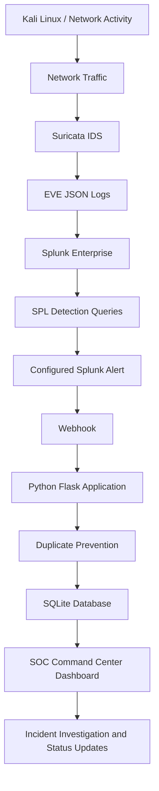

# Splunk SIEM + Suricata IDS
### Real-Time Threat Detection & Automated SOC Ticketing

## Project Overview

Developed a hands-on SOC monitoring and incident management solution by integrating **Suricata IDS with Splunk Enterprise** and a custom **Python Flask ticketing application**.

The solution collects and analyzes network security events, identifies suspicious activity, generates automated alerts, and creates incident tickets through a webhook integration.

It demonstrates a practical security monitoring and incident management workflow.

## Key Features

| Feature | Description |
|---|---|
| SIEM Integration | Centralized Suricata event monitoring in Splunk |
| Network Threat Detection | Analysis of Suricata EVE JSON events |
| SPL Detection Queries | Searches for suspicious network activity |
| Automated Alerting | Splunk alert configuration |
| Webhook Integration | Sends alert data to Flask |
| Automated Ticket Creation | Creates incident tickets from security alerts |
| Duplicate Prevention | Prevents duplicate ticket creation for matching incidents |
| Incident Management | Open, In Progress and Resolved statuses |
| SOC Dashboard | Ticket statistics, search, filtering and incident tracking |

## Architecture

## Technology Stack

- **SIEM:** Splunk Enterprise
- **IDS:** Suricata
- **Programming:** Python
- **Backend:** Flask
- **Database:** SQLite
- **Query Language:** Splunk Processing Language (SPL)
- **Operating System:** Ubuntu Linux
- **Testing Environment:** Kali Linux
- **Integration:** HTTP Webhook / JSON
- **Virtualization:** VMware

## Project Screenshots

### 1. SOC Command Center Dashboard

Overview of security incidents, ticket counts, severity levels, and incident statuses.

### 2. Splunk Suricata Event Monitoring

Suricata EVE JSON events searched and analyzed using Splunk SPL.

### 3. Splunk Alert and Webhook Configuration

Configured Splunk alert actions to send event data to the Flask webhook endpoint.

### 4. Flask Ticketing Server

Flask application running and receiving webhook requests.

### 5. Webhook Ticket Creation Test

Tested webhook integration using a JSON payload and verified successful ticket creation.

### 6. Security Incident Details

Incident details including severity, source IP, occurrence count, timestamps, and original event payload.

## Incident Management Workflow

1. Suricata monitors network traffic and generates security events.
2. Events are written to EVE JSON logs.
3. Splunk collects and indexes the events.
4. SPL searches identify relevant security activity.
5. Configured Splunk alerts trigger when their conditions are met.
6. Webhook sends alert data to the Flask application.
7. Flask processes the payload and checks for duplicates.
8. New incidents are stored in SQLite.
9. SOC dashboard displays tickets for investigation and tracking.

## Ticketing Application Features

- Automated ticket creation through webhook.
- Unique SOC ticket ID generation.
- Severity and incident information.
- Source and destination IP tracking when provided.
- Occurrence count and event timestamps.
- Duplicate alert prevention.
- Incident status management.
- Search and filtering.
- Dashboard summary cards.

## Example Incident

| Field | Example |
|---|---|
| Incident | Possible SSH Brute Force Attack |
| Ticket ID | SOC-58320509 |
| Severity | High |
| Source IP | 192.168.113.131 |
| Occurrences | 23 |
| Status | Open |

*Example values from the lab demonstration.*

## Repository Documentation

- [Implementation Guide](documentation/implementation-guide.md)
- [Splunk Detection Queries](splunk/detection-queries.md)
- [Ticketing Application](ticketing-app/README.md)
- [Testing and Validation](testing/test-cases.md)

## Skills Demonstrated

- SIEM monitoring and log analysis
- Network security event investigation
- Splunk SPL queries
- IDS and SIEM integration
- Alert configuration and webhook integration
- Python Flask application development
- Incident creation and tracking
- Basic SOC incident management workflow

## About the Developer

**Bhupender Dhankhar**

B.Tech – Computer Science & Engineering (Cyber Security)  
Gurugram University

Aspiring SOC Analyst | SIEM | Network Security | Threat Detection | Incident Response

[LinkedIn Profile](https://www.linkedin.com/in/bhupender-dhankhar-41299a351)

## Disclaimer

This project was developed for educational purposes in an authorized virtual lab. All testing was conducted on systems under my control or with permission.
